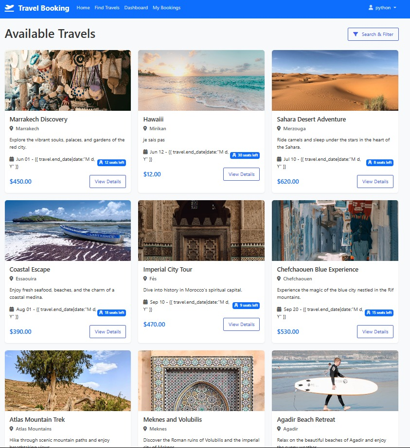
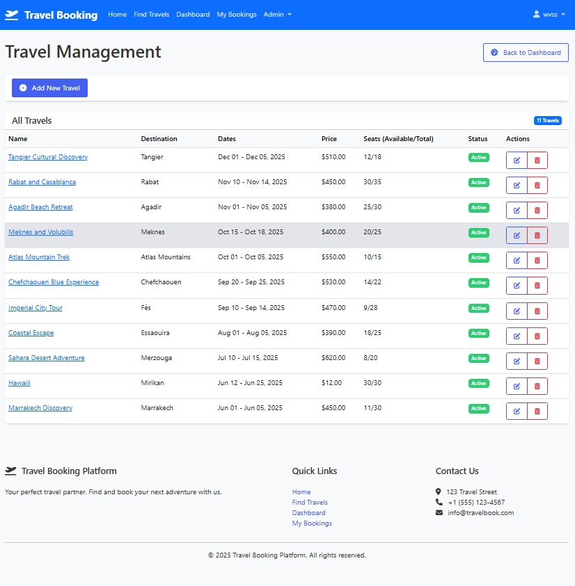
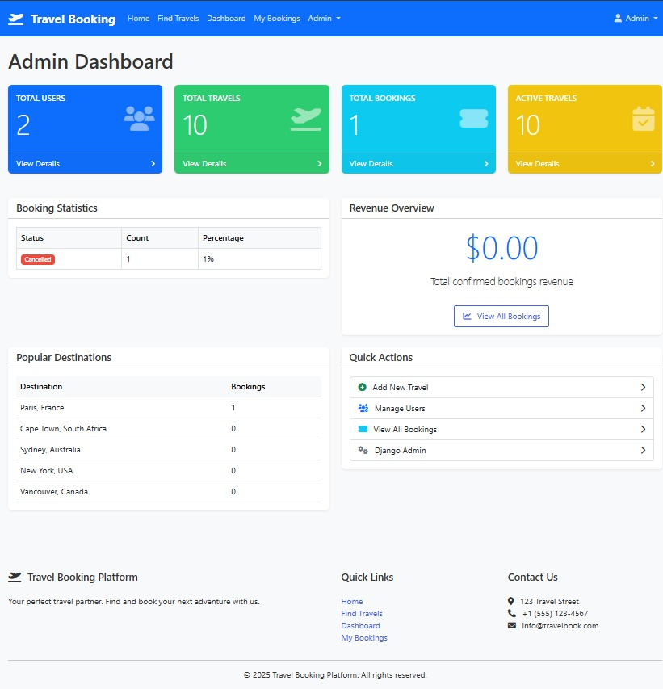
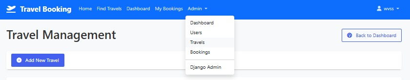
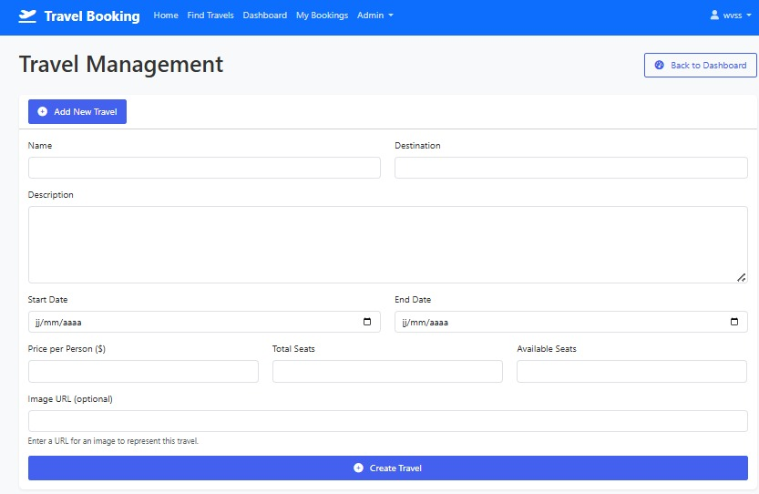
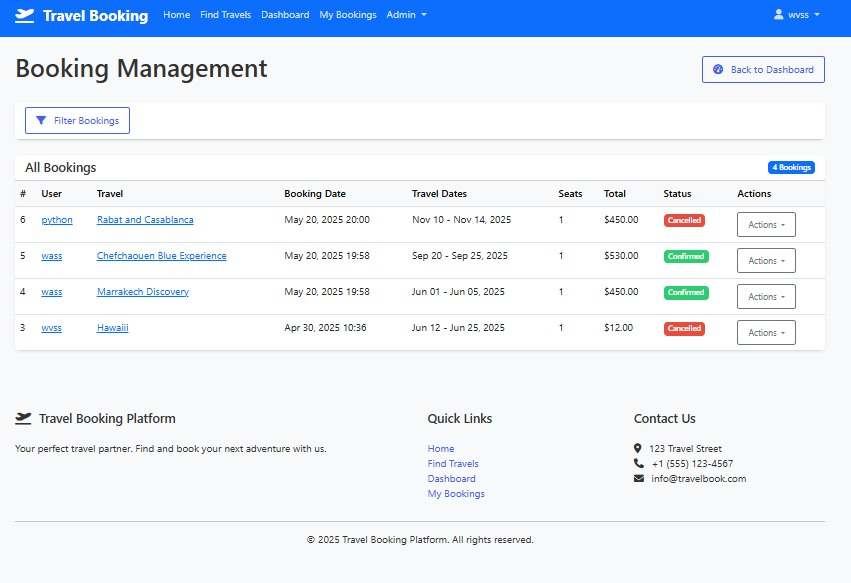

# Travel Booker

Travel Booker is a Django web application for browsing trips and managing bookings. It includes separate traveler and staff-facing workflows.

## Features

- Browse and filter trips by destination, dates, and price
- Create and cancel bookings and view personal booking history
- Staff pages for managing trips and reviewing booking statistics
- Django authentication and role-restricted staff access

The project includes screenshots of the main traveler and administration screens.

## Technology

- Python
- Django 4.2
- MySQL
- Django templates, HTML, and CSS

## Local setup

### Requirements

- Python 3
- MySQL server and development headers required by `mysqlclient`

Create a MySQL database and configure the database connection in the Django settings for your local environment. Do not reuse the repository's development credentials in a deployed environment.

### Install and run

From the repository root:

```bash
python -m venv .venv
```

Activate the environment, then install the pinned dependencies:

```bash
pip install -r requirements.txt
python manage.py migrate
python manage.py runserver
```

The development server prints its local URL when it starts. If the sample-data script is used, treat its accounts and data as local demo fixtures only; never expose them on a public deployment.

## Screenshots












